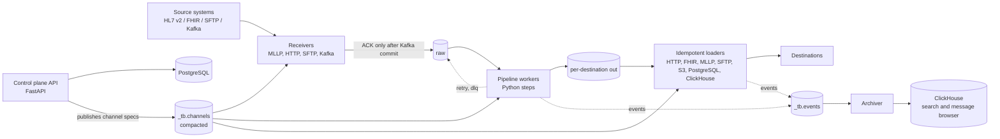

<div align="center">

# Tributary

**A Kafka-centric, Python-native healthcare integration engine.**
Durable HL7 v2 and FHIR messaging where every guarantee is measured, tested and written down.


[](LICENSE)

</div>

---

## Why this exists

Hospitals and labs move clinical messages between systems all day: admissions, lab results, orders. The incumbent open-source engine for this, Mirth Connect, keeps its message store in a relational database, runs transformations in embedded JavaScript, and ties real clustering to a commercial tier. Tributary asks a different question: **what if the message log was the architecture?**

| Pain point in the incumbent model | Tributary's answer |
|---|---|
| Channels live as XML in an app database, edited in a desktop client | **Channels are declarative specs in Git**: reviewable, diffable, promotable, roll-back-able |
| Transformers are embedded JavaScript with weak testing | **Transformers are plain typed Python functions** of `(message, ctx)`, unit-testable without Kafka |
| The relational message store is on the critical path | **Kafka is the backbone.** Retry, replay, fan-out and scale-out come from the platform |
| Browsing messages slows message flow | **The archive is off the critical path**: an archiver streams into ClickHouse and nothing waits on it |
| Scaling out is a paid feature | **Horizontal scaling is partitions and consumer groups** |

## Architecture at a glance



The diagram shows the target architecture; [Status](#status) says what has landed. Kafka appears only at **durability boundaries** (`raw`, per-destination `out`, `retry`, `dlq`, `reply`, `_tb.events`). Steps inside a pipeline run in-process, so the engine does not pay a network hop per transformation.

## Ten invariants, enforced rather than aspirational

These are the project's non-negotiables. Changing one needs a new architecture decision record approved by a human.

1. **ACK after commit.** A sender is acknowledged only after the message is committed to Kafka (`acks=all`, idempotent producer). If Kafka is down, the receiver refuses or NACKs. It never ACKs and drops.
2. **Kafka hops only at durability boundaries.**
3. **The data plane is independent.** Receivers, workers and loaders keep running when PostgreSQL, the API or ClickHouse is down. Specs come from a compacted topic.
4. **At-least-once delivery.** Every loader documents and tests its idempotency technique keyed by `tb-msg-id`.
5. **Ordering is explicit.** Per-key ordering comes from the channel spec, with `blocking` or `retry-topic` retry per destination. Nothing is reordered silently.
6. **No PHI in logs, metric labels, trace attributes, exception messages or test output.**
7. **Channels are declarative; steps are testable without Kafka.**
8. **Metadata in Kafka headers, payload as opaque bytes**, with claim-check for payloads over 1 MB.
9. **The archive is off the critical path.**
10. **Clean-room and permissive licensing.** No code copied from Mirth/OIE or any MPL/GPL source. Dependencies are limited to Apache-2.0, MIT, BSD, ISC and PSF, and a CI licence check enforces it.

## Evidence, not claims

Before building, the riskiest assumptions were turned into measured spikes (see [`docs/spikes/`](docs/spikes/)). The verdict was **GO WITH CHANGES**: no invariant had to change, and two planning numbers that turned out wrong were corrected in the design.

| What was tested | Result |
|---|---|
| Acknowledged-message loss under 20 broker leader kills | **0 lost**, 244,710 messages acknowledged |
| ACKs while Kafka is unavailable | **0 ACKs** inside the outage window, 6 of 6 trials |
| Per-key order under consumer kills, rebalances and a transactional crash | **0 order violations** across 2,000 modelled fault schedules, 12 cluster scenarios and 13 integration tests |
| Cooperative-sticky rebalance | A joiner took exactly **2 of 6** partitions, with no duplicates |
| Transactional Kafka-to-Kafka stage, killed mid-transaction | **0 duplicates, 0 losses** after restart |
| Topic scale | 1,000 channels healthy at 3 partitions per topic. **The original 12-partition default failed at about 425-450 channels**, so the default was changed |
| HL7 v2 parse throughput (lazy parser, one core) | **about 36,000 msg/s**, versus about 2,400 for `python-hl7` |

Two results were **not** met, and the project says so: the 50 ms p99 ACK-latency target was not reached as measured (the cause is unresolved), and the migration-effort estimate is a reasoned guess with no corpus behind it. All numbers were taken on one developer laptop and are order-of-magnitude, not capacity-planning figures. The full memo with the caveats is [`docs/spikes/PHASE-0-DECISION.md`](docs/spikes/PHASE-0-DECISION.md).

## What is in the repository

| Package | Purpose |
|---|---|
| [`tributary-sdk`](packages/tributary-sdk) | `Message`, `@step`, `ctx` interfaces and test helpers |
| [`tributary-runtime`](packages/tributary-runtime) | Kafka consumer loop, pipeline executor, retry, DLQ, ordering, transactions, events, synchronous reply |
| [`tributary-receivers`](packages/tributary-receivers) | Inbound connectors: MLLP, HTTP/FHIR, SFTP, Kafka |
| [`tributary-loaders`](packages/tributary-loaders) | Outbound connectors with idempotent delivery |
| [`tributary-hl7v2`](packages/tributary-hl7v2) | Lazy HL7 v2 parser, serializer, accessors, ACK builder |
| [`tributary-fhir`](packages/tributary-fhir) | FHIR helpers over pydantic models |
| [`tributary-content-hl7-fhir`](packages/tributary-content-hl7-fhir) | Reference HL7 v2 to FHIR R4 mappings (ADT A01/A03/A08, ORU R01) |
| [`tributary-archiver`](packages/tributary-archiver) | Event archive into ClickHouse, the message-browser backend, off the critical path |
| [`tributary-api`](packages/tributary-api) | Control plane: PostgreSQL schema, Alembic migrations and repositories. The FastAPI routes, RBAC and audit trail are in review (see Status) |

Alongside the code:

- [`contracts/`](contracts) holds the **contract-first** surface: envelope, topic naming, event schema, channel-spec JSON Schema, OpenAPI, and a validator (`contracts/validate.py`) that checks every example, valid and invalid.
- [`deploy/`](deploy) has a Docker Compose stack and a Helm chart (Strimzi, KEDA autoscaling, network policies, OpenTelemetry).
- [`docs/adr/`](docs/adr) holds the architecture decision records, starting with [ADR-001](docs/adr/ADR-001-kafka-centric-python-integration-engine.md).
- [`tests/`](tests) and [`benchmarks/`](benchmarks) hold conformance, integration (testcontainers), chaos and end-to-end tests, and the spike harnesses.

## How it is built

- **Contract-first.** Schemas and OpenAPI are versioned artefacts. Code follows them, and breaking changes need an ADR.
- **Python 3.12+** with `uv`, `asyncio` with `uvloop`, `orjson` and pydantic v2. `mypy --strict` runs on every package, together with `ruff`.
- **Kafka 4.x (KRaft)** with `confluent-kafka`, cooperative-sticky assignment and static membership.
- **Security as a first-class concern.** An ADR-driven Kafka role model gives each component exactly the grants it needs, checked by deny-by-default ACL tests. PHI is kept out of logs, metric labels and exceptions by design.
- **Reviewed work.** Each change goes through an independent code review, and anything touching auth, listeners, PHI or dependencies also goes through a security review. The reviewers' findings are tracked and closed before merge.
- **AI-assisted team workflow.** The project is developed by a human-led team of AI agents with defined roles (architect, platform, connector, archive, control-plane, QA, DevOps and read-only reviewers). The workflow, ownership map and phase plans are documented in [`docs/agent-team/`](docs/agent-team).
- **Synthetic data only.** No real patient data exists anywhere in the repository. HL7 fixtures set MSH-3 to `TRIBUTARY-SYNTH`, and a hook blocks fixtures that do not.

## Getting started

```bash
uv sync                                                    # install the workspace
uv run ruff check . && uv run ruff format --check .        # lint and format
uv run mypy packages                                       # strict type check
uv run pytest -m "not integration and not chaos and not bench"   # fast tests
uv run pytest -m integration                               # testcontainers: Kafka, ClickHouse, PostgreSQL
docker compose -f deploy/compose/docker-compose.yml up -d  # single-host lite stack
```

The integration tests need Docker. See [`deploy/compose/README.md`](deploy/compose/README.md) for the lite stack.

## Status

Tributary is under active development.

- **Phase 0**: architecture validated by measured spikes (GO WITH CHANGES).
- **Phase 1**, waves 1 and 2: HL7 v2 and FHIR libraries, the MLLP and HTTP receivers, the pipeline runtime with retry, DLQ and ordering, loaders, synchronous reply, and the Compose stack.
- **Phase 1**, wave 3, first batch (on `main`): the PostgreSQL schema and migrations, the archiver's event path into ClickHouse, the Helm chart, and the receivers' exact-grant ACL tests.
- **Phase 1**, wave 3, remainder (in review on the `wave/1-3` branch): the control-plane REST API with OIDC authentication, RBAC, TLS and an append-only audit trail; archive search, content views, reprocess and replay; a live event stream; and operations tooling.
- **Next**: web console, Mirth/OIE channel importer, Kubernetes operator.

Project status and the plan for each wave are in [`docs/agent-team/STATUS.md`](docs/agent-team/STATUS.md).

## Licence

Licensed under the [Apache License 2.0](LICENSE). Every dependency is restricted to permissive licences (Apache-2.0, MIT, BSD, ISC, PSF), and a CI licence check enforces it.

---

<div align="center">
<sub>Tributary is a working codename. Trademark checks are pending before the name is adopted.</sub>
</div>
